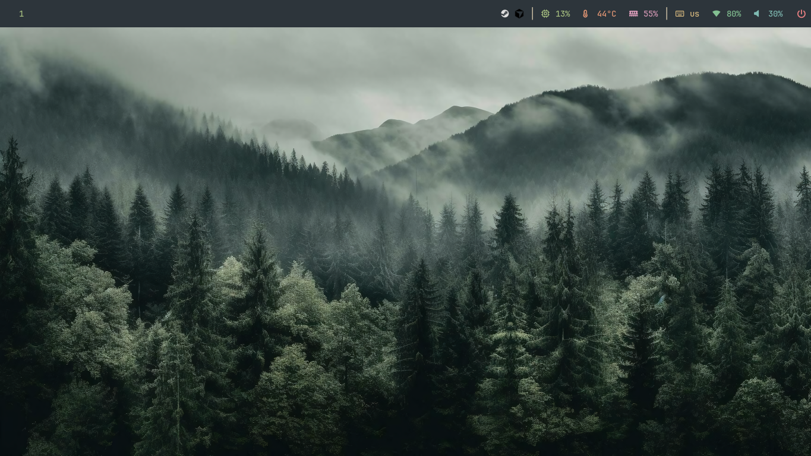

# Niri Dotfiles

A minimal and clean desktop setup for **Niri on Arch Linux**, using the Everforest Dark color scheme.

The goal of this project is to create a comfortable desktop with simple colors, useful tools, and keyboard-based window management.

## Screenshots



## Features

- **Niri** — scrollable tiling window manager for Wayland
- **Waybar** — minimal status bar
- **Everforest Dark** — dark colors with soft green accents
- **Alacritty** — terminal emulator
- **Wofi** — application launcher
- **Mako** — notification daemon
- **wl-clipboard** — Wayland clipboard tools
- **cliphist** — clipboard history
- **udiskie** — automatic mounting of removable drives
- **Polkit** — graphical authentication agent
- **swaybg** — wallpaper manager
- **GNU Stow** — dotfiles management
- **Nautilus** — file manager

The configuration uses JetBrainsMono Nerd Font and a dark green color palette.

## Color Palette

| Color | Hex | Usage |
|---|---|---|
| Background | `#2d353b` | Main background |
| Foreground | `#d3c6aa` | Main text |
| Green | `#a7c080` | Active elements |
| Muted | `#859289` | Inactive elements |
| Border | `#475258` | Window borders |
| Yellow | `#dbbc7f` | Hover effects |
| Red | `#e67e80` | Warnings and errors |

## Requirements

These dotfiles are designed for Arch Linux and Arch-based distributions, such as EndeavourOS.

You need:

- Git
- GNU Stow
- Niri
- Waybar
- Alacritty
- Wofi
- Mako
- JetBrainsMono Nerd Font

Additional tools are used for clipboard history, wallpapers, screen locking, audio controls, brightness control, removable drives, and authentication.

## Installation

### 1. Install the packages

On Arch Linux or EndeavourOS, install the main packages:

```bash
sudo pacman -S git stow niri waybar alacritty wofi mako \
  wl-clipboard cliphist udiskie udisks2 polkit polkit-gnome \
  swaybg swaylock brightnessctl playerctl nautilus
```

Make sure that the required Wayland audio tools are also installed if you want to use the media and volume shortcuts.

### 2. Clone this repository

```bash
git clone https://github.com/o0travaa/niri-dotfiles.git ~/dotfiles
cd ~/dotfiles
```

### 3. Create a backup

If you already have configuration files, back them up before using Stow. Stow cannot create a link if a conflicting file already exists.

For example:

```bash
cp -r ~/.config/niri ~/.config/niri.backup
```

Repeat this for other configuration directories if needed.

### 4. Link the configurations

Run these commands from the repository directory:

```bash
stow niri
stow waybar
stow alacritty
stow wofi
stow mako
```

Stow creates links from the repository to the correct locations in your home directory.

If you already have files in these locations, resolve any conflicts before running Stow.

### 5. Configure the wallpaper

The Niri configuration starts `swaybg` using this file:

```text
~/dotfiles/pictures/wallpapers.png
```

Make sure your wallpaper exists at this location. You can replace it with your own image and update the Niri configuration if necessary.

### 6. Start Niri

Log out from your current desktop session and select **Niri** in your display manager.

Waybar, Mako, the wallpaper, clipboard history, removable drive mounting, and the Polkit authentication agent are configured to start with Niri.

## Keybindings

The **Mod key** is the Super key, usually the Windows key on a keyboard.

### Applications and session

| Keybinding | Action |
|---|---|
| `Mod + Enter` | Open Alacritty |
| `Mod + D` | Open Wofi |
| `Super + Alt + L` | Lock the screen |
| `Mod + Shift + Slash` | Show the hotkey overlay |
| `Mod + Shift + E` | Exit Niri |
| `Ctrl + Alt + Delete` | Exit Niri |
| `Mod + Shift + P` | Turn off monitors |

### Window management

| Keybinding | Action |
|---|---|
| `Mod + Backspace` | Close the focused window |
| `Mod + Left / H` | Focus the column on the left |
| `Mod + Right / L` | Focus the column on the right |
| `Mod + Up / K` | Focus the window above |
| `Mod + Down / J` | Focus the window below |
| `Mod + Home` | Focus the first column |
| `Mod + End` | Focus the last column |
| `Mod + Ctrl + Left / H` | Move the column left |
| `Mod + Ctrl + Right / L` | Move the column right |
| `Mod + Ctrl + Up / K` | Move the window up |
| `Mod + Ctrl + Down / J` | Move the window down |
| `Mod + F` | Toggle fullscreen |
| `Mod + M` | Maximize the column |
| `Mod + V` | Toggle floating mode |
| `Mod + Shift + V` | Switch focus between floating and tiled windows |
| `Mod + W` | Toggle tabbed column display |
| `Mod + C` | Center the focused column |
| `Mod + Ctrl + C` | Center visible columns |

### Workspaces

| Keybinding | Action |
|---|---|
| `Mod + 1–9` | Switch to workspace 1–9 |
| `Mod + Page Up / I` | Focus the workspace above |
| `Mod + Page Down / U` | Focus the workspace below |
| `Mod + Ctrl + 1–9` | Move the column to workspace 1–9 |
| `Mod + Ctrl + Page Up / I` | Move the column to the workspace above |
| `Mod + Ctrl + Page Down / U` | Move the column to the workspace below |
| `Mod + Shift + Page Up / I` | Move the workspace up |
| `Mod + Shift + Page Down / U` | Move the workspace down |
| `Mod + O` | Toggle the overview |

### Layout controls

| Keybinding | Action |
|---|---|
| `Mod + R` | Switch column width preset |
| `Mod + Shift + R` | Switch to the previous width preset |
| `Mod + Minus` | Decrease column width |
| `Mod + Equal` | Increase column width |
| `Mod + Shift + Minus` | Decrease window height |
| `Mod + Shift + Equal` | Increase window height |
| `Mod + Ctrl + R` | Reset window height |
| `Mod + Ctrl + Shift + R` | Switch window height preset |
| `Mod + Bracket Left` | Consume or expel window to the left |
| `Mod + Bracket Right` | Consume or expel window to the right |
| `Mod + Comma` | Consume window into a column |
| `Mod + Period` | Expel window from a column |

### Screenshots

| Keybinding | Action |
|---|---|
| `Print` | Take a screenshot of a selected area |
| `Ctrl + Print` | Screenshot the whole screen |
| `Alt + Print` | Screenshot the focused window |

### Audio and brightness

| Keybinding | Action |
|---|---|
| `XF86AudioRaiseVolume` | Increase volume |
| `XF86AudioLowerVolume` | Decrease volume |
| `XF86AudioMute` | Toggle audio mute |
| `XF86AudioMicMute` | Toggle microphone mute |
| `XF86AudioPlay` | Play or pause media |
| `XF86AudioStop` | Stop media |
| `XF86AudioPrev` | Previous track |
| `XF86AudioNext` | Next track |
| `XF86MonBrightnessUp` | Increase screen brightness |
| `XF86MonBrightnessDown` | Decrease screen brightness |

### Mouse and scrolling

| Keybinding | Action |
|---|---|
| `Mod + Mouse Wheel Up / Down` | Switch workspaces |
| `Mod + Mouse Wheel Left / Right` | Focus columns |
| `Mod + Ctrl + Mouse Wheel Up / Down` | Move the column to another workspace |
| `Mod + Shift + Mouse Wheel Up / Down` | Focus columns left or right |
| `Mod + Ctrl + Shift + Mouse Wheel Up / Down` | Move columns left or right |

## Troubleshooting

### Niri does not load the configuration

Check the configuration:

```bash
niri validate
```

Niri supports live configuration reloads, so most changes can be applied without logging out.

### Waybar does not start

Try running it manually:

```bash
waybar
```

Check the terminal output for errors.

### Notifications do not appear

Make sure Mako is running:

```bash
mako
```

### Wallpaper is missing

Check that the wallpaper file exists:

```bash
ls ~/dotfiles/pictures/wallpapers.png
```

You can also test it manually:

```bash
swaybg -i ~/dotfiles/pictures/wallpapers.png -m fill
```

### USB drives do not mount automatically

Check that UDisks2 and udiskie are installed and that udiskie is running in your Niri session.

## Customization

You can edit the configuration files in this repository to change colors, spacing, fonts, keybindings, and other settings.

After changing a configuration, reload the related application or your Niri configuration if needed.

## Credits

- [Niri](https://github.com/niri-wm/niri)
- [Waybar](https://github.com/Alexays/Waybar)
- [Everforest](https://github.com/sainnhe/everforest)

## License

These are personal configuration files. Check the licenses of the individual projects and themes before redistributing their work.
